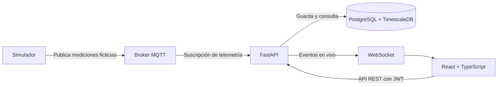

# Arquitectura de GridWatch

## Alcance

GridWatch presenta telemetría eléctrica **simulada** y permite consultar
instalaciones, equipos, mediciones, alertas, reportes y eventos de auditoría.
No envía comandos a equipos físicos ni incorpora protocolos de control
industrial. La interfaz mostrará con claridad que los datos son de demostración.

## Componentes

- **Frontend:** React, TypeScript, Tailwind CSS y Recharts. Consume la API
  versionada para consultas y WebSocket para actualizaciones en vivo.
- **Backend:** FastAPI. Organiza rutas, servicios y acceso a datos por módulos
  de dominio. Valida entradas y aplica permisos según el rol.
- **Base de datos:** PostgreSQL para usuarios, instalaciones, equipos, reglas de
  alerta y auditoría. TimescaleDB almacena la serie temporal de mediciones.
- **Telemetría:** un simulador separado publica mensajes en un espacio de
  tópicos MQTT reservado para la demostración. El backend valida cada mensaje,
  persiste la medición, evalúa umbrales y difunde el resultado a clientes web.

## Modelo conceptual

- `installation` contiene varios `equipment`.
- `equipment` produce `measurement` con fecha UTC, voltajes y corrientes por
  fase, potencia activa, frecuencia y marca de calidad/origen simulado.
- `alert_rule` define umbrales por equipo y magnitud; `alert_event` conserva
  aperturas y cierres de alertas.
- `user` tiene un rol inicial: **administrador**, **operador** u **observador**.
- `audit_event` registra acciones de usuario relevantes, con actor, momento y
  entidad afectada. No se usa como sustituto del historial de mediciones.

El [modelo de datos](data-model.md) detalla el esquema físico, las unidades y
los índices. La retención automática queda pendiente de definir para la
demostración. Las marcas de tiempo se almacenan como instantes UTC y se
mostrarán en la zona horaria del usuario.

## Límites y seguridad

- La API autentica con JWT y verifica autorización en el backend, además de
  ocultar acciones no permitidas en la interfaz.
- Los secretos provienen de variables de entorno; `.env` no se versiona.
- La ingesta acepta únicamente el formato de telemetría definido para el
  simulador. Los mensajes inválidos se rechazan y registran.
- MQTT transporta solo datos de demostración; no se definen tópicos de mando.
- Reportes y consultas históricas se paginan o acotan por rango de fechas para
  evitar respuestas excesivas.

## Criterios de evolución

Cada fase debe dejar instrucciones de ejecución y pruebas para sus componentes.
Los cambios de esquema se gestionarán con migraciones. Los servicios se podrán
iniciar por separado durante el desarrollo y juntos mediante Docker Compose en
la fase DevOps.
