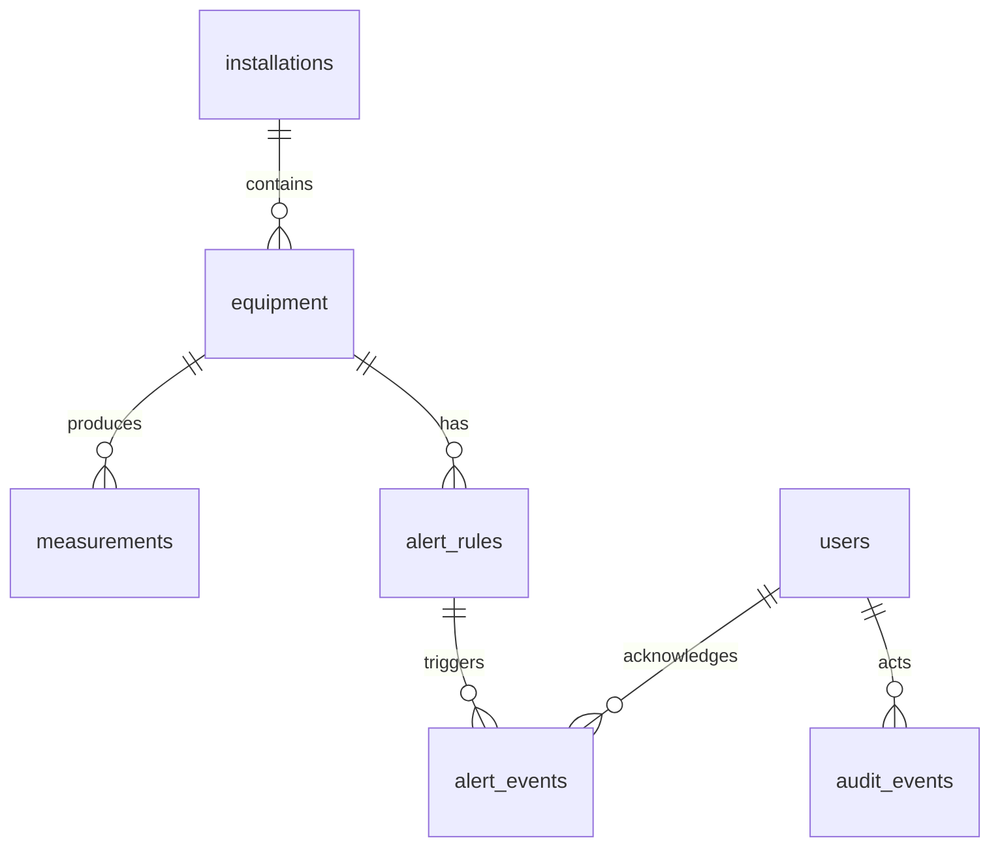

# Modelo de datos

La migración inicial está en `backend/migrations/versions/0001_initial_schema.py`.
La revisión `0002_one_active_alert_per_rule.py` añade un índice único parcial
que permite como máximo una alerta abierta o reconocida por regla. La revisión
`0003_measurement_retention.py` crea la función de retención de mediciones de
35 días, dejando margen para los reportes de hasta 31 días. El servicio
`retention` de Compose la ejecuta diariamente.
Los modelos SQLAlchemy que usará la API están en `backend/app/db/models.py`.

| Tabla | Propósito y claves |
| --- | --- |
| `users` | Cuenta, hash de contraseña y rol `admin`, `operator` o `viewer`; correo único en minúsculas. |
| `installations` | Sitio de tipo mina, central hidroeléctrica o subestación; código único. |
| `equipment` | Equipo asociado a una instalación; código único dentro de ella. |
| `measurements` | Hipertabla de lecturas; clave compuesta `(equipment_id, measured_at)`. |
| `alert_rules` | Umbral mínimo, máximo o ambos para una magnitud de un equipo; una regla por pareja equipo/magnitud. |
| `alert_events` | Apertura, reconocimiento y resolución de una alerta; conserva el instante de la lectura que la activó. |
| `audit_events` | Acción realizada, actor opcional y detalles JSON; no guarda telemetría. |

## Lecturas eléctricas

Cada fila de `measurements` representa una muestra de un equipo. `measured_at`
es el instante de origen y `received_at` el de recepción. Ambos son
`timestamptz`; la API deberá enviar fechas conscientes de UTC.

| Campo | Unidad | Significado |
| --- | --- | --- |
| `voltage_l1_v`, `voltage_l2_v`, `voltage_l3_v` | V | Voltaje por fase. |
| `current_l1_a`, `current_l2_a`, `current_l3_a` | A | Corriente por fase. |
| `active_power_kw` | kW | Potencia activa; puede ser negativa para representar el sentido del flujo. |
| `frequency_hz` | Hz | Frecuencia medida. |
| `quality` | — | `valid` o `invalid`; la API definirá cuándo se asigna cada estado. |
| `source` | — | Solo `simulator` en esta demostración. |

Las magnitudes de voltaje, corriente y frecuencia no admiten valores negativos.
Al menos una magnitud debe estar presente. La API validará además que los
números sean finitos antes de almacenarlos. La clave compuesta permite tratar
como duplicado un mensaje repetido para el mismo equipo e instante.

## Reglas, alertas y auditoría

Las reglas admiten las ocho magnitudes de `measurements`. Exigen al menos un
límite y, si hay dos, el mínimo debe ser menor que el máximo. El evento de
alerta referencia la regla; el equipo se obtiene desde ella. `measurement_at`
queda como marca histórica sin clave foránea a la hipertabla, de modo que una
futura política de retención de muestras no borre el contexto de las alertas.

`audit_events.actor_id` es opcional para eventos del sistema. Los usuarios y
equipos referenciados se protegen con `ON DELETE RESTRICT`; en la API se
preferirá desactivar usuarios o equipos antes que eliminarlos.

## Índices y evolución

La clave de `measurements` contiene `measured_at`, requisito de los índices
únicos en hipertablas particionadas por tiempo. También favorece las consultas
de historial por equipo. Hay índices para alertas por regla/estado/fecha y
auditoría por fecha. El servicio de mantenimiento ejecuta diariamente
`drop_chunks`, que elimina chunks completos anteriores a 35 días. Puede conservar algunas
lecturas más antiguas hasta que el chunk entero cumpla el plazo. Las alertas
y la auditoría no están sujetas a esa política. No hay agregados continuos.

La primera migración crea la extensión `timescaledb` si falta, convierte
`measurements` con `create_hypertable(..., by_range('measured_at'))` y deja la
extensión instalada al revertir. Este uso de `by_range` requiere TimescaleDB
2.13 o posterior. Referencias: [API de creación de hipertablas](https://www.tigerdata.com/docs/reference/timescaledb/hypertables/create_hypertable)
y [restricción de índices únicos](https://github.com/timescale/docs/blob/latest/use-timescale/hypertables/hypertables-and-unique-indexes.md).
